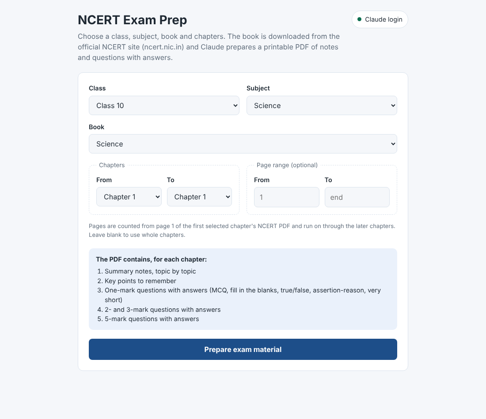
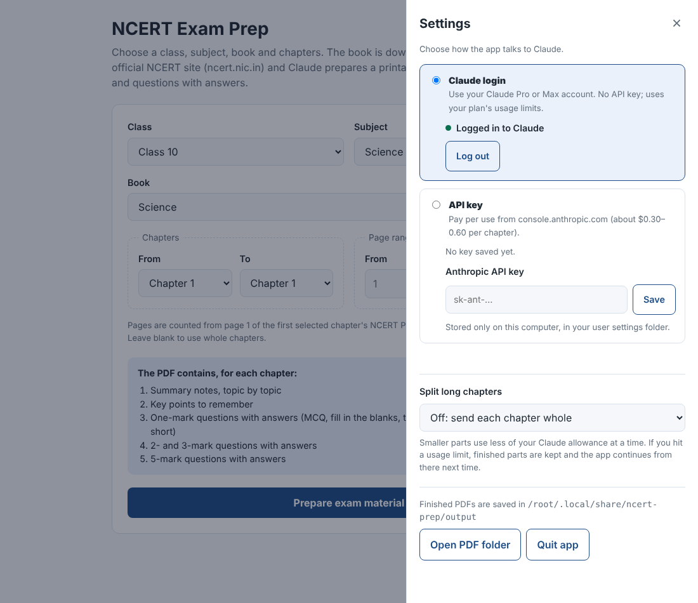

# NCERT Exam Prep

A desktop app for CBSE students and teachers (Ubuntu/Linux and Windows). Choose a **class,
subject, book, chapters and (optionally) pages**. The app downloads the chapters from the
official NCERT site (ncert.nic.in), has Claude write the exam preparation material, and saves a
**printable A4 PDF** with, for each chapter:

1. **Summary notes**: every topic explained as short points
2. **Key points** to remember: definitions, formulae, equations, laws
3. **One-mark questions with answers**: MCQ, fill in the blanks, true/false, very short answer, assertion-reason
4. **2-mark and 3-mark questions with answers**, including the NCERT exercise questions
5. **5-mark questions with answers**

Sample output: [`samples/Class10_Science_Ch1_Chemical_Reactions_and_Equations.pdf`](samples/Class10_Science_Ch1_Chemical_Reactions_and_Equations.pdf)



Settings panel (opened from the top-right corner):



## Two ways to use Claude (pick in Settings, top-right corner)

| | **Claude login** | **API key** |
|---|---|---|
| What you need | A Claude **Pro or Max** subscription (Free doesn't include Claude Code) | An API key from console.anthropic.com |
| Cost | Included in your plan; uses your plan's usage limits | Pay per use, about $0.30–0.60 per chapter |
| How it works | Through Claude Code, Anthropic's command-line tool, signed in to your account | Direct calls to the Claude API |
| Setup | Click **Log in with Claude** in Settings | Paste the key in Settings |

Each person uses their own Claude account or key; nothing is shared.

## Install on Ubuntu / Linux

One command downloads, installs and adds the desktop shortcut (no GitHub login needed):

```bash
curl -fsSL https://raw.githubusercontent.com/vskgopus/public/ncert-prep/ncert_prep/setup.sh | bash
```

Run the same command again any time to update. Your login, settings and PDFs are kept.
Or do it by hand:

```bash
git clone -b ncert-prep https://github.com/vskgopus/public.git ~/ncert-app
cd ~/ncert-app/ncert_prep && ASSUME_YES=1 bash install.sh
```

The installer:
- installs the Python packages into `ncert_prep/.venv`
- adds **NCERT Exam Prep** to the app menu and desktop
- offers to install Claude Code (needed only for Claude login)

Then open **NCERT Exam Prep** from the app menu, or run `./ncert-prep.sh`. Python 3.10+ is
needed (Ubuntu 22.04 and later have it). If the installer says the `venv` module is missing,
it offers to run `sudo apt install python3-venv` for you.

## Install on Windows 10/11

1. Download https://github.com/vskgopus/public/archive/refs/heads/ncert-prep.zip and unzip it.
2. In the `ncert_prep` folder, double-click **`install.bat`**. It checks for Python (offering
   to install it), installs the packages, creates Desktop and Start-menu shortcuts, and offers
   to install Claude Code.
3. Open **NCERT Exam Prep** from the desktop.

## First start

The Settings panel opens. Choose one:
- **Claude login**: click **Log in with Claude**. A browser tab opens; sign in and approve.
  The dot turns green.
- **API key**: paste your `sk-ant-…` key and click **Save**.

Then choose the book and chapters and click **Prepare exam material**. A chapter takes a
few minutes. Click **Open PDF to print** when it's done. PDFs are also kept in:
- Linux: `~/.local/share/ncert-prep/output`
- Windows: `%LOCALAPPDATA%\ncert-prep\output`

### Saving your Claude allowance

- **Settings → Split long chapters** sends a chapter in parts of 8, 12 or 16 pages.
- Every finished part is saved. If you hit your plan's usage limit, click **Prepare** again
  after it resets; the app reuses the saved parts and continues from where it stopped.

## Files

| File | Role |
|---|---|
| `launcher.py` | Starts the app on this computer only (127.0.0.1) and opens it in an app window |
| `app.py`, `templates/index.html` | The page, settings, background jobs |
| `ncert.py` | Reads NCERT's catalogue into `catalog.json`; downloads chapter PDFs; cuts page ranges |
| `generator.py` | Prompt, output schema, and the API-key engine |
| `claude_cli.py` | The Claude-login engine (Claude Code: status, login, one request per chapter) |
| `settings.py` | Settings in `~/.config/ncert-prep/settings.json` (Windows: `%APPDATA%\ncert-prep`), readable only by you |
| `pdf_render.py`, `fonts/` | Printable PDF layout with the bundled DejaVu font (so H₂O, x², √, → print on any computer) |
| `certs/` | Public Let's Encrypt intermediate certificates. ncert.nic.in doesn't send its own, so this lets downloads verify properly |
| `install.sh`, `ncert-prep.sh` | Linux installer and launcher |
| `install.bat`, `install.ps1`, `start.bat` | Windows installer and launcher |
| `pro/index.html` | A no-install page: NCERT links and a prompt to paste into claude.ai by hand |

Notes:
- Only English-medium books are offered for now. Hindi and Urdu need different PDF fonts and text shaping.
- Up to 6 chapters per PDF.
- To pick up new NCERT books, run `.venv/bin/python ncert.py` to refresh `catalog.json`.
- The model for the API key engine can be changed with the `NCERT_PREP_MODEL` environment variable.

## Test

```bash
.venv/bin/python tests/test_end_to_end.py
```

This tests both engines without spending money. It uses real NCERT downloads, with Claude
replaced by a mock API and a stand-in `claude` command. It also covers chapter splitting and
resuming.
